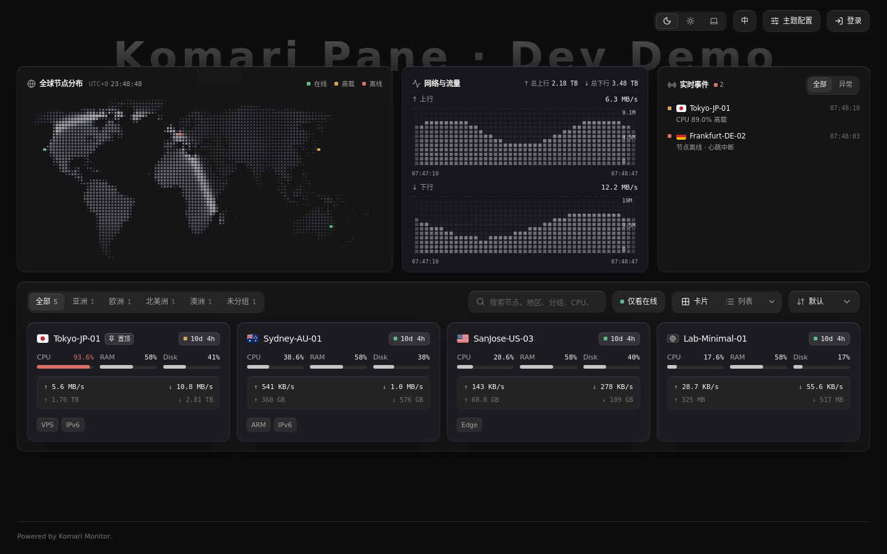

# Komari Pane

Komari Pane 是 [Komari Monitor](https://github.com/komari-monitor/komari) 的只读仪表盘主题。用 Solid Glass 的面板、卡片与浮层区分信息层级；不替换 Komari 的管理后台或终端。

`v1.0.0` · `Solid Glass` · [MIT](./LICENSE) · [English overview](#english-overview)



## 安装与快速开始

1. 按[本地打包和开发](#本地打包和开发)生成 `komari-theme-pane-1.0.0.zip`；发布后可从 [GitHub Releases](https://github.com/PRSSTRA/komari-theme-pane/releases) 下载。不要上传 GitHub 自动生成的源码包。
2. 在 Komari 后台的**主题管理**上传并启用 **Komari Pane**，回到站点首页查看节点。导航栏右侧的**登录 / 管理后台**始终打开 Komari 自带的 `/admin`。
3. 在后端主题页设置公告、顶部标语、置顶节点及其他站点默认值。访客可从首页**主题配置**调整本机的地图、总览与透明度；**恢复站点默认**清除本地覆盖。

## 看什么

- 点阵世界地图使用 208×96 轮廓，提供 UTC+8 时钟、晨昏线以及重叠节点的聚合和散开。坐标由上报地区和机房名线索估算，不用于精确定位。
- 网络、负载与 Ping 使用细方格图表。网络速率按字节大小切换单位；总览分别汇总上行和下行累计流量，不估算「今日流量」。Ping 轨道可显示采样内的部分丢包与完整超时。
- 标准卡片、紧凑卡片和列表共享分组、搜索和排序。节点详情保留系统信息、配额和公开记录；没有 Ping 任务的节点不显示 Ping 标签。
- 页面提供明暗双模、跟随系统和低透明模式。费用、到期时间和临期事件仅在会话已登录且站点开启 `show_pricing` 时显示；公开 API 字段的访问控制仍由 Komari 服务端负责。

## 后台托管配置

| 配置键 | 默认值 | 用途 |
| --- | --- | --- |
| `hero_title` | 空 | 顶部标语，留空使用站点名 |
| `site_notice` | 空 | 首页公告，留空隐藏 |
| `show_world_map` | `true` | 全球节点分布 |
| `map_overlap_mode` | `cluster` | 聚合；也可选择 `spread` 散开 |
| `show_map_clock` | `true` | UTC+8 地图时钟 |
| `show_solar_terminator` | `true` | 地图晨昏线 |
| `show_summary_bar` | `true` | 网络与流量总览 |
| `show_event_feed` | `true` | 实时节点事件 |
| `default_view` | `card` | `card` 卡片或 `table` 列表 |
| `card_density` | `comfortable` | 标准卡片；`compact` 为紧凑卡片 |
| `show_offline_first` | `true` | 默认排序下，离线节点优先跟在置顶节点之后 |
| `show_total_traffic` | `true` | 节点累计流量 |
| `show_tags` | `true` | 节点标签 |
| `show_load_temp` | `false` | Load 和有上报的温度 |
| `show_traffic_bar` | `false` | 有限配额时显示用量进度条 |
| `show_pricing` | `false` | 向已登录会话显示费用及到期信息；不可本地覆盖 |
| `featured_nodes` | `[]` | 后台配置的置顶节点 |
| `featured_ping_tasks` | `[]` | 优先展示的关联 Ping 任务，每个节点最多三条 |
| `reduce_transparency` | `false` | 不透明面板，减少背景模糊 |
| `footer_extra` | 空 | 页脚追加纯文本 |

## 本地打包和开发

在仓库根目录执行。需要 Node.js 22.13+、pnpm 11 和 Info-ZIP 的 `zip`。

```sh
pnpm install --frozen-lockfile
pnpm package
```

打包结果在 `release/komari-theme-pane-1.0.0.zip`。修改源码后可用 `pnpm typecheck` 检查类型。

连接 Komari 调试：

```sh
VITE_API_TARGET=http://127.0.0.1:25774 pnpm dev
```

将地址换成测试实例；也支持原来的 `KOMARI_URL`。未连接可用后端时，开发模式可用演示数据；私有站点仍按权限展示，生产构建不包含演示数据。

## English overview

Komari Pane is a read-only Solid Glass theme for Komari Monitor. It includes a dot-matrix topology map, network and load histories, Ping latency and loss tracks, and synchronized card and table views. The theme leaves Komari’s `/admin` and terminal intact.

**Quick start:** With Node.js 22.13+, pnpm 11, and Info-ZIP installed, run `pnpm install --frozen-lockfile` and `pnpm package`. Upload `release/komari-theme-pane-1.0.0.zip` in Komari’s theme manager, enable **Komari Pane**, and open the site homepage. Once published, the same ZIP will be available from [Releases](https://github.com/PRSSTRA/komari-theme-pane/releases). Do not upload GitHub’s automatic source archives.

Use the admin theme settings to pin nodes, select Ping tasks, and set site-wide defaults. Visitors can change display preferences in their own browser and restore site defaults at any time.

For development, run `VITE_API_TARGET=http://127.0.0.1:25774 pnpm dev` and replace the example URL with the address of your test Komari instance.

## 致谢和许可

感谢 [Komari Monitor](https://github.com/komari-monitor/komari)、[Solid Glass](https://github.com/deeplethe/solid-glass) 与 Natural Earth。主题采用 [MIT License](./LICENSE)。相关接口和安装约定见 [Komari 主题开发指南](https://komari-document.pages.dev/dev/theme)。
