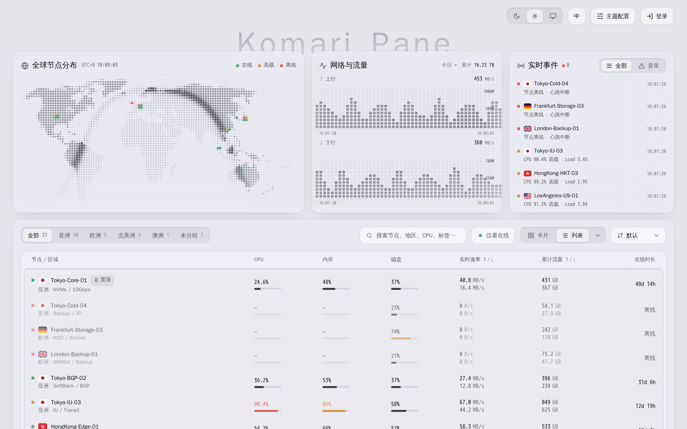
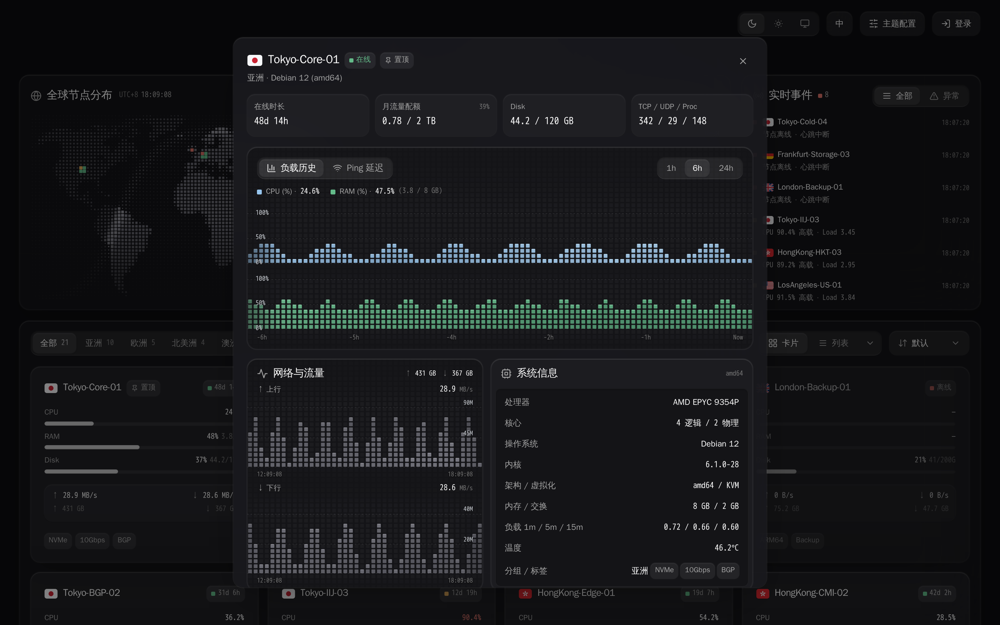
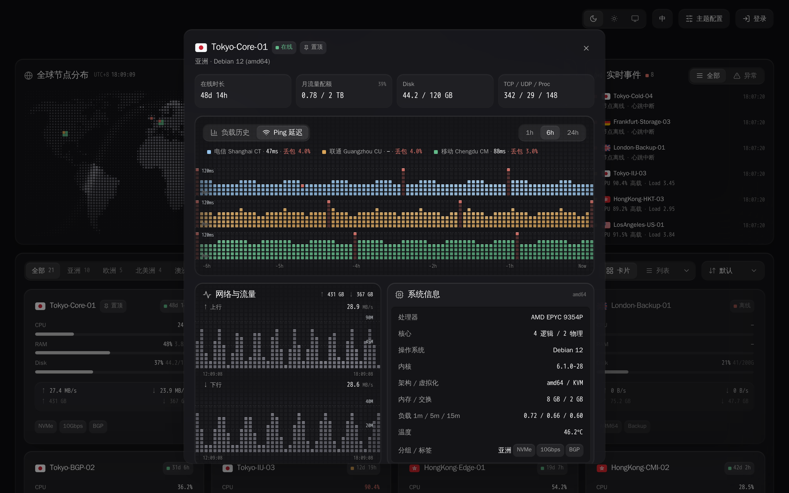
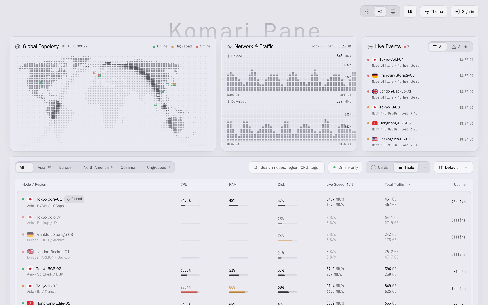
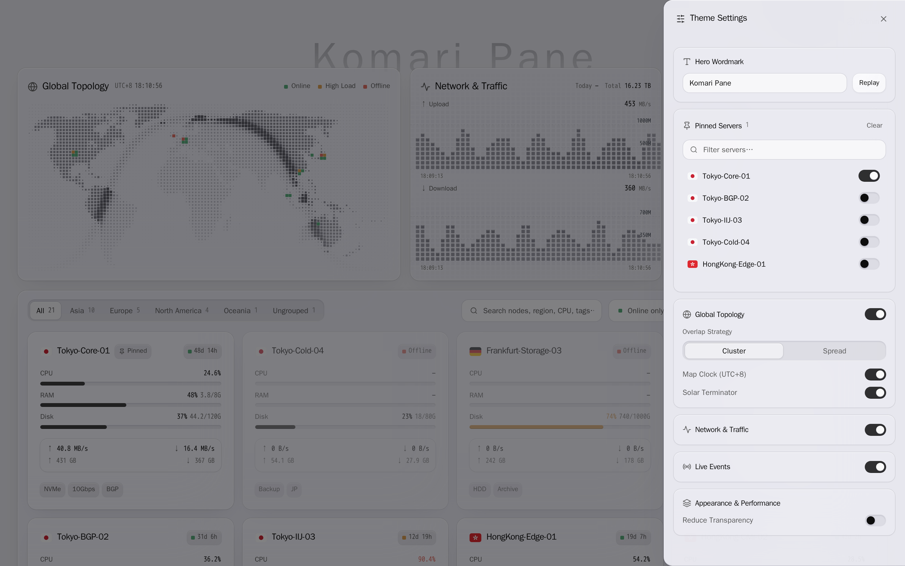
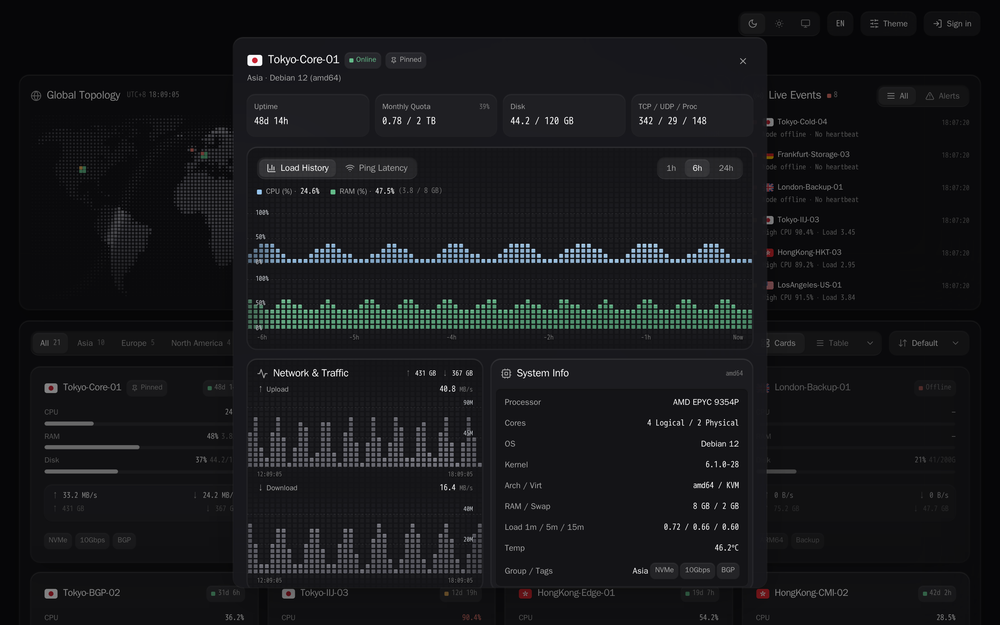
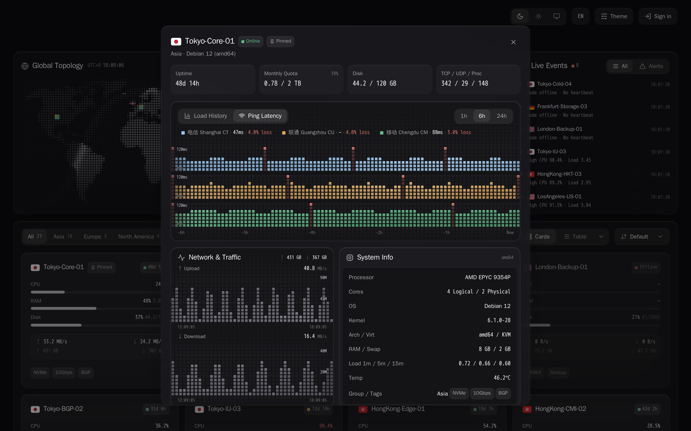

# Komari Pane


[中文文档](#中文文档) · [English Overview](#english-overview)


---

## 中文文档

**Komari Pane** 是面向 [Komari Monitor](https://github.com/komari-monitor/komari) 的监控主题，使用 **JavaScript、Vite、Tailwind CSS v4** 和 **Solid Glass** 设计系统，将节点状态、流量和历史指标集中呈现在一个面板中。

### 核心特性

- **外观与材质**：采用 Solid Glass 玻璃视觉风格，支持深色 / 浅色 / 跟随系统切换、中英双语切换，以及低透明高性能模式。
- **世界地图**：点阵式全球节点分布图，支持实时太阳晨昏线、重合节点聚合或展开显示，点击可直达节点详情。
- **遥测与历史图表**：实时展示全网与单节点网络速率及流量汇总，详情页支持 CPU / 内存负载历史，以及多轨 Ping 延迟与丢包可视化。
- **多视图与筛选**：提供标准卡片、紧凑卡片与列表三种视图，支持分组、搜索、仅看在线筛选及多维度排序。
- **访客偏好配置**：内置主题配置抽屉，访客可按个人习惯调整界面显示，并支持一键恢复站点默认。

### 界面预览

| 列表视图（浅色主题） | 主题配置抽屉 |
| :---: | :---: |
|  |  |
| **节点详情 · 负载与网络历史** | **节点详情 · 多轨 Ping 延迟** |
|  |  |

---

### 安装与使用

1. 按下方步骤构建主题 ZIP，例如 `temp/komari-theme-pane-1.0.2.zip`，无需解压。
2. 登录你的 Komari Monitor 管理后台，进入 **主题管理（Theme Management）**。
3. 上传 ZIP 并启用 **Komari Pane**，打开站点首页查看节点。
4. 可在后台主题设置中修改顶部自定义标语、置顶服务器和公告。

---

### 本地开发与自行构建

```bash
# 克隆仓库并安装依赖
git clone https://github.com/PRSSTRA/komari-theme-pane.git
cd komari-theme-pane
npm install

# 生产构建并打包
npm run package
```

ZIP 输出到 `temp/komari-theme-pane-<版本号>.zip`。如需本地预览，启动开发服务器并将 API 和 WebSocket 代理到可访问的 Komari 后端：

```bash
VITE_API_TARGET=http://127.0.0.1:25774 npm run dev
```

---

## English Overview

**Komari Pane** is a theme for [Komari Monitor](https://github.com/komari-monitor/komari), built with **JavaScript, Vite, Tailwind CSS v4**, and the **Solid Glass** design system.

### Highlights

- **Appearance & Materiality**: Solid Glass styling with Dark / Light / System modes, Chinese & English UI, and a reduced-transparency performance mode.
- **World Map**: Dot-matrix global node map with a live solar terminator, overlap clustering or spreading, and quick access to node details.
- **Telemetry & Charts**: Live aggregate and per-node network throughput, traffic totals, CPU/RAM load history, and multi-track Ping latency with packet-loss visualization.
- **Multiple Views & Filtering**: Switch between standard cards, compact cards, and table view, with group tabs, search, online filtering, and sorting.
- **Visitor Preferences**: Built-in settings drawer for customizing local display options with one-click reset to site defaults.

### Screenshots

| Table View (Light Theme) | Theme Settings Drawer |
| :---: | :---: |
|  |  |
| **Node Details · Load & Network History** | **Node Details · Multi-Track Ping Latency** |
|  |  |

---
### Quick Start

1. Build the theme ZIP as shown below, for example `temp/komari-theme-pane-1.0.2.zip`. Do not extract it.
2. Open your Komari Admin panel → **Theme Management**.
3. Upload the ZIP, activate **Komari Pane**, and open your site's home page to view its nodes.
4. Optionally set the hero wordmark, pinned servers, and announcement in the admin theme settings.

---
### Development & Build

```bash
npm install
npm run package
```

The archive is written to `temp/komari-theme-pane-<version>.zip`. For local development, point the dev server at a running Komari backend to proxy API and WebSocket traffic:

```bash
VITE_API_TARGET=http://127.0.0.1:25774 npm run dev
```

---

## Credits & License

- **[Komari Monitor](https://github.com/komari-monitor/komari)** — Server monitoring backend and theme ecosystem
- **[Solid Glass (`deeplethe/solid-glass`)](https://github.com/deeplethe/solid-glass)** — Physical glass surface tokens and component styling
- **Repository**: [https://github.com/PRSSTRA/komari-theme-pane](https://github.com/PRSSTRA/komari-theme-pane)
- **License**: Released under the [MIT License](./LICENSE) © 2026 **Prstra**
